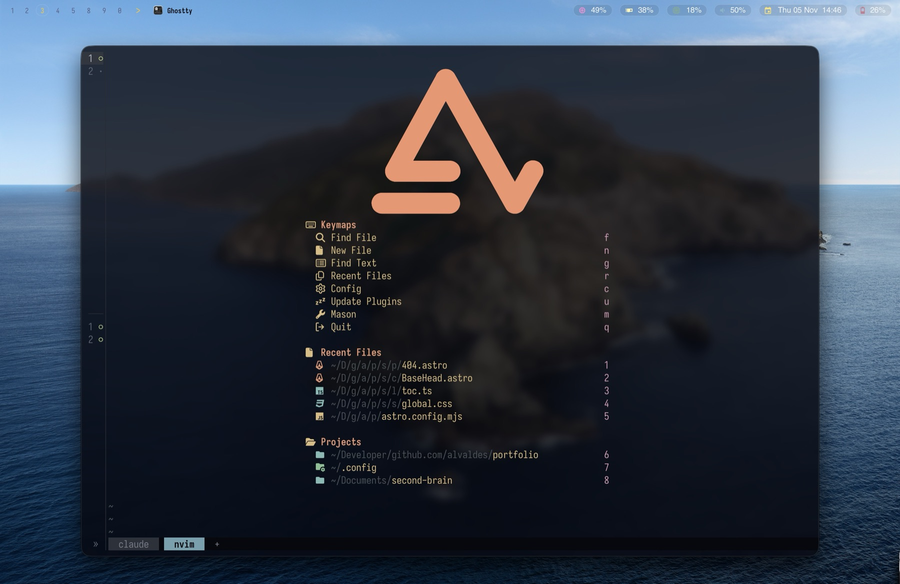

# alvaldes.dots

Personal macOS configuration, versioned so a new machine can be brought back to
the same state.

## Layout

The repository root **is** `~/.config`. Everything follows the
[XDG Base Directory](https://specifications.freedesktop.org/basedir-spec/latest/)
layout, so `$HOME` stays clean: `install.sh` only adds the `~/.zshenv` symlink
and an empty `~/.hushlogin` (which silences the "Last login" banner).

```text
~/.config/                  <- this repository
├── zsh/                    .zshenv  .zshrc  .zprofile  (ZDOTDIR)
├── git/                    config  ignore
├── nvim/  ghostty/  aerospace/  sketchybar/  herdr/  ...
├── scripts/                helper scripts
├── .githooks/              pre-commit secret scan
├── .github/workflows/      CI secret scan
├── .betterleaks.toml       scanner config and allowlists
├── install.sh
└── .gitignore
```

Every directory mirrors `~/.config/<dir>` one to one, so cloning the
repository into `~/.config` puts those files in place with no extra step.

### XDG layout

`~/.zshenv` is the only zsh entry in `$HOME`, because zsh reads it before it
knows where the rest lives. It is a symlink to `zsh/.zshenv`. It exports the XDG base directories and points
`ZDOTDIR` at `~/.config/zsh`. Each tool then finds its files without a symlink:

| What | Where |
|---|---|
| zsh config (`.zshrc`, `.zprofile`) | `~/.config/zsh/` via `ZDOTDIR` |
| zsh history | `~/.local/state/zsh/history` via `HISTFILE` |
| zsh completion dump | `~/.cache/zsh/zcompdump-<version>` via `compinit -d` |
| Python REPL history (3.13+) | `~/.local/state/python_history` via `PYTHON_HISTORY` |
| git config and global ignore | `~/.config/git/config`, `~/.config/git/ignore` (read natively) |
| mise (node, rust) | `~/.config/mise/config.toml`; installs in `~/.local/share/mise` (XDG native) |
| sdkman, bun, gradle, cocoapods, gems, ipython | `~/.local/share/<tool>` via `SDKMAN_DIR`, `BUN_INSTALL`, `GRADLE_USER_HOME`, `CP_HOME_DIR`, `GEM_HOME`, `IPYTHONDIR` |
| npm, bun, gem, bundler, matplotlib caches | `~/.cache/<tool>` via `npm_config_cache`, `BUN_INSTALL_CACHE_DIR`, `GEM_SPEC_CACHE`, `BUNDLE_USER_CACHE`, `MPLCONFIGDIR` |
| Jupyter config | `~/.config/jupyter` via `JUPYTER_CONFIG_DIR` |
| Bundler config | `~/.local/share/bundle/config` via `BUNDLE_USER_CONFIG` (kept out of this public repo: it can hold gem-server credentials) |

All of these are exported in `zsh/.zshenv`, so they reach every zsh, including
non-interactive scripts. **GUI apps launched from the Dock never read it**: an
app config that hardcodes `~/.nvm/...` or `~/.sdkman/...` breaks silently, so
point app configs at commands on `PATH` instead.

Not moved on purpose:

- `~/.codex`: Codex's own `config.toml` hardcodes paths under it, the desktop
  app does not read shell variables, and `CODEX_HOME` inside `~/.config` would
  put `auth.json` in this public repository.
- `~/.m2`, `~/.conda`, `~/.swiftpm`, `~/.ssh`: no supported relocation variable,
  or managed by macOS/Xcode.

Git checks `~/.gitconfig` first, so a stray file there shadows the XDG one.
Don't recreate it.

Git identity is deliberately **not** versioned. `git/config` includes
`~/.gitconfig.local`, which you create on each machine:

```ini
[user]
	name = <your name or handle>
	email = <your email or GitHub noreply address>
```

Note that `git config --global` now writes to `~/.config/git/config`, which is
tracked. Put personal or machine-specific values in `~/.gitconfig.local`
instead.

## Install on a new machine

```sh
git clone https://github.com/alvaldes/alvaldes.dots.git ~/.config
~/.config/install.sh --dry-run   # review the plan
~/.config/install.sh             # create the symlinks in $HOME
exec zsh -l
```

`install.sh` replaces an existing `$HOME` file by moving it into
`~/.dotfiles-backup-<timestamp>/` first, and re-running it is safe: an
already-correct symlink is reported and skipped. It also removes dangling
symlinks that still point into the repository, such as `~/.zshenv` from when it
lived in a `home/` directory.

Then create `~/.gitconfig.local` with your git identity (see
[XDG layout](#xdg-layout)).

### After cloning

This repository keeps hand-written configuration only. Plugins, themes, and
other downloaded assets are reinstalled by the tool that owns them, not
restored from here.

## What is versioned, and why

Rule: only the configuration needed to rebuild this machine is versioned.
`.gitignore` is a **file allowlist**: a file is published only when its exact
path is listed there, and whole trees are allowed only for hand-written code.
Credentials, caches, logs, and app state therefore stay out by default, without
the repository having to name them.

Never allowlist a file that holds a credential. If a config needs a secret,
publish a copy with placeholder values under a different name and keep the
real file out of the allowlist.

## Secret scanning

This repository is public, so a committed secret is published the moment it is
pushed. Two layers guard against it, plus one manual recipe for forensics.

```sh
# What the pre-commit hook runs, on demand:
betterleaks git --pre-commit --staged --redact

# Full history:
betterleaks git . --redact

# Everything tracked in the working tree:
betterleaks dir . -c .betterleaks.toml --redact
```

`install.sh` points `core.hooksPath` at `.githooks/`, so a fresh clone gets the
pre-commit hook. The hook refuses to commit when a staged file is outside the
`.gitignore` allowlist (only `git add -f` can stage one), or when the staged
content trips a scanner rule. Bypass one commit with
`SKIP=betterleaks git commit ...` for a confirmed false positive, then add an
allowlist entry to `.betterleaks.toml`.

Install the scanner with `brew install betterleaks`. The hook fails open with a
warning if it is missing, so an uninstalled optional tool never blocks a commit.

### The blind spot: read this before trusting a clean scan

Both betterleaks and gitleaks scan with `git log -p --all`. That sees only
commits **reachable from refs**. A credential that was pushed and later rewritten
out of history survives as a dangling object and is **invisible to both tools**.
Verified empirically, not assumed:

| Method | Finds a rewritten-out secret? |
| --- | --- |
| `git log -p --all` (what the scanners run) | **no** |
| `git rev-list --all` + `git grep` | **no** |
| `git log -p --reflog` | yes, while the reflog survives |
| `git cat-file --batch-all-objects --batch` | **yes** |
| `git fsck --unreachable` locally | no — a reflog-reachable object counts as reachable |
| `git fsck --unreachable` on a bare remote | **yes** — the remote has no reflog |

Consequences worth keeping straight:

- **Scanners are prevention, not forensics.** Neither one would have found the
  credential that leaked from this repository.
- **To audit, use the object store.** A clean scanner run is not proof of a clean
  repository.
- **A supported way to see rewritten-out commits**, before the reflog is purged:

  ```sh
  betterleaks git --log-opts="--reflog --all" .
  ```

  Note that `--log-opts` **replaces** the scanner's default arguments, so `--all`
  must be passed again or only HEAD is scanned. Once the reflog is gone this scan
  returns clean **by vacuity**, which is not the same as clean. Never confuse the
  two.
- **Rewriting history is not a fix.** GitHub keeps serving an unreachable object
  by its SHA even after a force-push. Rotate the credential; that is the only
  real remediation.

### Why betterleaks and not gitleaks

gitleaks is feature complete and gets security patches only; its author moved to
betterleaks, which carries the `validate` feature: it proves whether a detected
secret is still live by making a request, instead of guessing. Install it with
`brew install betterleaks`.

## Neovim



A from-scratch config for Neovim 0.12+, with no distribution and no plugin
manager plugin: plugins are declared with the built-in `vim.pack` and pinned
in `nvim/nvim-pack-lock.json`.

```text
nvim/
├── init.lua                entry point
├── nvim-pack-lock.json     pinned plugin revisions (vim.pack)
├── after/lsp/              per-server LSP settings
├── colors/                 gentleman colorscheme (Ghostty palette)
├── assets/                 dashboard logo
└── lua/alvaldes/
    ├── config/             options, keymaps, autocmds, commands
    ├── plugins/            vim.pack declarations and plugin setup
    ├── themes/             colorscheme sources
    └── utils/              lualine, tabline, lazygit helpers
```

- **UI:** everforest with a transparent background; every floating window
  shares the snacks picker look (no fill, line-only border). Messages and the
  cmdline use the built-in `ui2`.
- **Core plugins:** snacks (picker, dashboard, notifier, lazygit), blink.cmp,
  treesitter, conform, mason, gitsigns, oil, flash, which-key, copilot.
- **Dashboard logo:** `assets/logo.svg` is drawn through the kitty graphics
  protocol (Ghostty supports it) after ImageMagick rasterizes it; other
  terminals get an ASCII fallback.

On the first launch `vim.pack` installs the plugins from the lockfile and mason
installs the language servers and formatters.

`nvim-gentle/` is the previous LazyVim-based config. It stays on disk, out of
the repository, until the migration is complete.

## Adding new configuration

1. Add the file where the tool reads it, under `~/.config/<dir>`. If the tool
   only looks in `$HOME`, keep the file in its tool's directory and add an entry
   to `LINKS` in `install.sh`.
2. Run `git status` and confirm the file is meant to be public: this repository
   is **public on GitHub**.
3. Add `!/<dir>/` to the `.gitignore` allowlist; everything else stays ignored.
   If a file in it contains a secret, add a deny rule for it instead.
4. Keep generated files out. `git status` should show only hand-written files;
   `/tmp`-style artifacts, caches, lockfiles of downloaded binaries, and build
   output belong in `.gitignore`.

## Notes

- Commit messages follow Conventional Commits.
